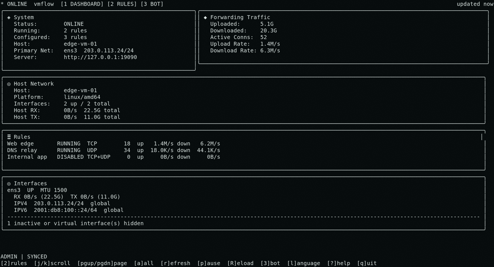

# vmflow - Go TCP/UDP Port Forwarding

**A bounded-resource Layer 4 (L4) proxy and embeddable Go networking runtime.**

vmflow is a self-hosted, cross-platform TCP/UDP port forwarding tool written in
pure Go. Run it as a single-binary network proxy or embed the forwarding runtime
in your own Go control plane, with explicit resource limits, hot-reloadable
rules, a terminal UI, and Prometheus metrics.

[](https://github.com/cloudapp3/vmdocs/tree/main/sites/vmflow/docs)
[](https://github.com/cloudapp3/vmflow/actions/workflows/go.yml)
[](https://pkg.go.dev/github.com/cloudapp3/vmflow)
[](LICENSE)

Documentation: [English quick start](https://github.com/cloudapp3/vmdocs/blob/main/sites/vmflow/docs/guide/quick-start.md) · [中文快速开始](https://github.com/cloudapp3/vmdocs/blob/main/sites/vmflow/docs/zh/quick-start.md) · [All docs source](https://github.com/cloudapp3/vmdocs/tree/main/sites/vmflow/docs)

> **完整使用指南:** [中文文档源码](https://github.com/cloudapp3/vmdocs/tree/main/sites/vmflow/docs/zh) —— 覆盖安装、配置、运维、安全加固与排错。English quick reference is below; the deep guide is in the [public docs source](https://github.com/cloudapp3/vmdocs/tree/main/sites/vmflow/docs).

<p align="center">
  
</p>

<p align="center"><sub>Real v0.3.0 TUI output: Host Network, TCP/UDP/tcp+udp rules, bandwidth and daily/monthly quotas, precheck, and language views.</sub></p>

## TCP/UDP port forwarding features

- TCP, UDP, and `tcp+udp` port forwarding
- Aggregate per-rule upload/download bandwidth limits with human-readable units
- Durable daily and monthly upload-plus-download traffic quotas
- Per-rule IPv4/IPv6 source allowlists and denylists with CIDR support
- Configurable TCP connection limits and bounded UDP sessions, with rejection/drop counters
- Rule lifecycle management: start, stop, restart, and full snapshot apply
- Config-driven foreground process with hot reload
- Local CLI/TUI management for rules, stats, precheck, reload, and metrics
- Read-only stdio MCP server for local AI-assisted diagnostics, with opt-in single-rule write tools
- Bearer-token auth with viewer/admin roles
- Structured logs in text or JSON format
- Prometheus-compatible `/metrics`
- Optional durable per-rule cumulative traffic and drop counters
- Rule precheck for loops, duplicate ports, and unavailable listeners
- Embeddable Go runtime for products that need in-process forwarding
- Terminal dashboard and rule management via `vmflow tui`

## Common use cases

- Forward TCP services such as SSH, databases, and internal APIs between hosts.
- Relay UDP services with bounded sessions, queues, idle cleanup, and drop metrics.
- Run a self-hosted Layer 4 proxy on Linux, macOS, or Windows as a native service.
- Inspect forwarding state and traffic from a local MCP client without exposing a new network service, and let an AI assistant configure single rules with the opt-in write mode.
- Embed TCP/UDP forwarding into a Go application, VPS panel, or network control plane.

## Quick start

Install the current stable release and put it on `PATH` for the current shell
(Linux/macOS):

```bash
VMFLOW_BIN_DIR="$(
  curl -fsSL https://raw.githubusercontent.com/cloudapp3/vmflow/main/install.sh \
    | bash -s -- --version v0.4.0 --print-install-dir
)" && export PATH="$VMFLOW_BIN_DIR:$PATH"
```

Omit `--version v0.4.0` to follow the latest stable release automatically. For
directory selection, `--system`, checksum verification, and shell startup-file
handling, see [Installation details](#installation-details).

Run the first-use wizard to choose a language, write the active configuration,
and pick a run mode:

```bash
vmflow init
```

The wizard enables authenticated management with a random admin token saved to
a mode-`0600` local client profile, so `vmflow ctl` and `vmflow tui` work
without a token on the command line. The bundled SSH forwarding example is
disabled and listens on loopback only; non-loopback listeners require an
explicit exposure confirmation. For the language resolution order and the
`-start` / `-install-service` script flags, see
[Installation details](#installation-details).

What happens after setup depends on the run mode selected in `vmflow init`:

- **Native system service:** vmflow is already installed, enabled, and running
  in the background. Do not start a second foreground process.
- **Foreground:** vmflow is already running and remains attached to the current
  terminal until interrupted.
- **Configure only:** no daemon is started. Start the saved user configuration
  later with:

```bash
vmflow run
```

Once a daemon is running, query it from another terminal:

```bash
vmflow ctl rules
vmflow ctl stats
vmflow ctl metrics
vmflow ctl precheck
```

The default local `vmflow tui` path manages the native service and first checks
that it is installed and running. Use it for system-service mode:

```bash
vmflow tui
```

For a daemon started manually in foreground mode, provide the loopback address
explicitly so the TUI connects to that process instead of requiring a native
service:

```bash
vmflow tui -addr http://127.0.0.1:19090
```

Show runtime status or build metadata with:

```bash
vmflow status
vmflow version -json
```

Or build from source:

```bash
git clone https://github.com/cloudapp3/vmflow.git
cd vmflow
go build -trimpath -o vmflow ./cmd/vmflow
./vmflow init
./vmflow run
```

## Installation details

The installer downloads GitHub Release archives, verifies `checksums.txt` with
SHA-256 by default, and writes only the `vmflow` executable. Release archives
keep `examples/config.yaml` as a reference; the installer never activates or
copies it. `vmflow init` creates the active configuration afterward, and
`vmflow run` uses the current user's config by default; `-config PATH` always
overrides automatic path selection.

Without an explicit `--dir`, the installer first reuses a conventional existing
vmflow installation directory. A fresh root install uses `/usr/local/bin`; an
unprivileged user prefers `~/.local/bin` or `~/bin` when either is already in
`PATH`, then falls back to `~/.local/bin`. For an automatic home-directory
install, the installer adds an idempotent entry to the selected shell's common
startup file (`.zshrc`, `.bashrc`, or `.profile`) and prints the exact reload
command; other shells receive a warning. Override the automatic directory with
`--dir PATH` or `VMFLOW_INSTALL_DIR`; explicit directories never modify shell
startup files. Use `--no-modify-path` to disable startup-file changes for an
automatic user install, `--print-install-dir` for machine-readable PATH
integration, and `--skip-verify` to skip checksum verification if needed. For
private releases or higher GitHub API limits, set `GITHUB_TOKEN` or `GH_TOKEN`.

To explicitly request a system installation, use `--system`. It writes directly
when already root and otherwise validates sudo before downloading, then uses
sudo only to prepare, inspect, and write the target directory:

```bash
curl -fsSL https://raw.githubusercontent.com/cloudapp3/vmflow/main/install.sh \
  | bash -s -- --version v0.4.0 --system
```

`--system` changes only the executable installation directory. Configuration is
still created later by `vmflow init`, which requests administrator privileges
only when the system-service choice needs the system config path.

### Run-mode and language options

`vmflow init` offers three run modes: install the native system service and run
in the background (recommended), run in the current terminal, or configure only.
System-service installation shows the resolved binary and config paths and
requires explicit confirmation before any administrator handoff. For scripts,
`-start` retains its foreground behavior; use `-install-service` to explicitly
install or update the native service and start it in the background. The two
flags are mutually exclusive.

The first wizard prompt displays numbered choices for English and Simplified
Chinese. Select `1` or `2`; pressing Enter keeps the shown default. The choice
is saved as the top-level `language` value in `config.yaml`. The prompt also
accepts `en` or `zh-CN` for compatibility. To change it later, set that field
to `en` or `zh-CN`. For a one-off override, use
`vmflow --lang zh-CN <command>` or set `VMFLOW_LANG`. Resolution order is
`--lang`, `VMFLOW_LANG`, `config.yaml`, then English.

## Configuration

See [`examples/config.yaml`](examples/config.yaml):

Default active config paths are scope-specific:

| Platform | System service | User / foreground |
| --- | --- | --- |
| Linux | `/etc/vmflow/config.yaml` | `${XDG_CONFIG_HOME:-$HOME/.config}/vmflow/config.yaml` |
| macOS | `/Library/Application Support/vmflow/config.yaml` | `~/Library/Application Support/vmflow/config.yaml` |
| Windows | `%ProgramData%\vmflow\config.yaml` | `%LocalAppData%\vmflow\config.yaml` |

`vmflow init --install-service` and `vmflow service install` use the system
path. `vmflow init --start` and `vmflow run` use the user path. An explicit
`-config PATH` wins in every mode.

```yaml
version: 1
language: en                       # CLI/TUI: en or zh-CN
control_port: 19090                  # management always binds to 127.0.0.1
udp_max_sessions: 256              # all UDP sessions in this process

log:
  level: info
  format: text

stats:
  persist: false                    # opt in to cumulative counter persistence
  # path: /var/lib/vmflow/stats.json # optional; relative paths use the config dir
  flush_interval: 60s               # minimum 1s; requires restart when changed

auth:
  enabled: false
  tokens:
    - name: admin
      token: change-me
      role: admin

rules:
  - rule_id: ssh-forward
    name: ssh-forward
    protocol: tcp
    listen_addr: 127.0.0.1
    listen_port: 2201
    target_addr: 127.0.0.1
    target_port: 22
    enabled: false
    bandwidth_limit:
      rate: 100 Mbps                 # shared by all connections, per direction
    # For asymmetric limits, omit rate and use either or both fields:
    # bandwidth_limit:
    #   upload: 50 Mbps
    #   download: 200 Mbps
    traffic_quota:
      daily: 100 GB                  # successful upload + download payload
      monthly: 1 TB
      timezone: Asia/Shanghai        # calendar day/month reset boundary
      action: block                  # optional; block is the default
    speed_limit: 0                   # legacy per-connection B/s limit
    max_conn: 0                     # TCP: unlimited; UDP: default of 256
    source_ip_mode: allowlist       # off, allowlist, or denylist
    source_ips:                     # literal IPv4/IPv6 or CIDR; max 256
      - 203.0.113.8
      - 198.51.100.0/24
      - 2001:db8:100::/48
```

DNS failover is automatic and has no configuration surface. Init target checks,
precheck, and TCP/UDP/HTTP/HTTPS outbound connections try the operating system
resolver first. On timeout or network failure, vmflow falls back in order to
`223.5.5.5:53` and `119.29.29.29:53`. A failed source is skipped for 30 seconds,
then retried automatically so recovered system DNS becomes primary again.
Definitive `NXDOMAIN` responses do not trigger public fallback, which avoids
leaking invalid or internal names. Literal IP targets bypass DNS entirely.

`bandwidth_limit` limits the aggregate traffic of one `rule_id`, rather than
each connection separately. Upload and download have independent token buckets.
`rate` applies the same configured rate to both buckets; it cannot be combined
with `upload` or `download`. With directional limits, an omitted direction is
unlimited. Every TCP connection and UDP session in the rule shares these
buckets, and a `tcp+udp` rule shares them across both protocols. vmflow permits
an automatically sized burst equal to roughly 100 ms of configured traffic,
clamped between 64 KiB and 4 MiB. The older integer `speed_limit` remains a
per-connection byte-per-second limit for compatibility.

Rate units are explicit and case-sensitive. Network-style `bps`, `Kbps`,
`Mbps`, `Gbps`, and `Tbps` are bits per second, so `100 Mbps` is
`12,500,000 B/s`. Byte-rate units include `B/s`, `KB/s`, `MB/s`, `GB/s`,
`TB/s`, and the binary forms `KiB/s`, `MiB/s`, `GiB/s`, `TiB/s`. Bare integer
values remain accepted as bytes per second for compatibility; ambiguous values
such as `100M` or `100mb` are rejected.

`traffic_quota` charges successful application payload bytes in both directions
to the same daily and monthly totals. `GB` and `TB` are decimal provider units;
`GiB` and `TiB` are binary units. `B`, `KB`, `MB`, `KiB`, and `MiB` are also
accepted, as are legacy bare integer byte counts. Calendar periods reset at
midnight or month start in the configured IANA timezone. TCP can forward the
final remaining bytes before closing; UDP datagrams are admitted whole or
dropped whole. Exhausted quotas block new traffic and automatically reopen in
the next period. Removing and re-adding a rule with the same `rule_id` retains
its current-period usage, so a configuration rewrite cannot reset allowance.
`block` is currently the only action.

Quota enforcement is durable even when `stats.persist` is false. vmflow stores
strict `quota-state.json` state beside the resolved stats file (or beside the
config when no stats path is configured), refuses path collisions, and fails
closed if quota state cannot be read or written. To prevent a crash or power
loss from restoring consumed allowance, runtime persistence reserves a small
conservative credit ahead of writes; a clean shutdown records exact usage.

`source_ip_mode` controls admission independently for each forwarding rule.
With `allowlist`, only peers matching `source_ips` are accepted; with
`denylist`, matching peers are rejected. Omit the fields or use `off` to allow
all peers. A configured allowlist or denylist must contain at least one entry.
Invalid modes, hostnames, malformed addresses, empty entries, and lists larger
than 256 are rejected during startup and precheck. TCP is checked before the
connection consumes `max_conn` or dials the target. UDP is checked before a
session consumes per-rule or manager-wide capacity. Updating a source IP policy
restarts that rule and closes its established TCP connections and UDP sessions
so the new policy takes effect immediately.

The policy matches the socket peer address. Behind NAT or a Layer 4 proxy that
address may be the gateway or proxy rather than the original client. vmflow
does not trust forwarded HTTP headers or PROXY protocol metadata. This is an
application-level admission control and does not replace a cloud firewall,
security group, or host firewall for volumetric attack filtering.

`udp_max_sessions` limits active UDP sessions across every rule owned by the
process (default `256`, maximum `4096`) and can be changed by config reload.
Lowering it below current usage does not terminate established sessions; it
rejects new UDP sessions until usage falls below the new limit. For each UDP
rule, `max_conn: 0` uses the default of `256`; for TCP, `max_conn: 0` remains
unlimited. On a `tcp+udp` rule, `max_conn` is enforced independently for TCP
connections and UDP sessions; UDP sessions also consume the process-wide limit.
Each UDP session owns a socket, a receive goroutine, and a 64 KiB receive
buffer. Check available memory and open-file limits before raising either cap.

Set `stats.persist: true` to preserve per-rule upload/download byte totals,
source-IP denial totals, and UDP rejection/drop counters across restarts. Active
connection counts and rates remain process-local. The foreground default is
`stats.json` beside the loaded config. The installed Linux systemd unit uses its
managed state directory
(`/var/lib/vmflow/stats.json`), including when running with `--user vmflow`.
An explicit relative `stats.path` is resolved beside the config file. vmflow
refuses to start if the stats path aliases the config file or cannot be written.

Hot reload applies only `rules` and `udp_max_sessions`. Changes to the local
management port, auth, TLS, logging, bot, ACME, certificate cache, certificate
review, or stats persistence require a vmflow process restart and are rejected
by reload while the old runtime settings remain active.

The management listener always binds to `127.0.0.1`; `control_port` changes only
its port. Use an SSH tunnel when CLI/TUI access is needed from another host.
Existing `control_listen_addr` values that name a loopback address are accepted
for one migration release with a deprecation warning. Non-loopback legacy values
are rejected; replace the field with `control_port` before upgrading.

### TUI rule management

`vmflow init` configures an admin token and local client profile by default, so
`vmflow tui` can manage `rules` and `udp_max_sessions` without a token argument.
Explicit `-token`, `VMFLOW_CONTROL_TOKEN`, and `VMFLOW_CLIENT_CONFIG` remain
available for custom deployments. Viewer tokens and sessions with auth disabled
are read-only. In the Rules view use `n`/`e`/`c` to create,
edit, or copy, `space` to toggle, `d` to delete, `g` for the global UDP limit,
`P` to precheck, `A` to apply, and `u` to discard the draft.
The rule editor's Source IPs / CIDRs field accepts comma-separated entries.
Shared bandwidth, daily quota, and monthly quota are in the basic editor;
directional bandwidth and quota timezone are under the advanced settings.

The Dashboard separates vmflow forwarding traffic from the connected daemon's
Host Network data. The host section includes interface state, MTU, IPv4/IPv6
CIDRs, cumulative RX/TX counters, and rates calculated from the existing
three-second stats polling interval. This remains the daemon host when the TUI
connects over an SSH tunnel or another remote transport. Press `4` to jump to
the Host Network section, `a` to switch between active physical interfaces and
all interfaces, and use the normal scroll keys for longer Dashboards. Interface
totals may include virtual-interface traffic; they are not vmflow port quotas,
a public-IP lookup, link-speed measurement, or bandwidth test.

Apply writes the validated draft to the config loaded by the running process,
which is the platform user config by default (or the explicit `-config` path).
Auth, TLS, logging, and other process settings still
require editing YAML and restarting vmflow.

## Commands

```bash
vmflow
vmflow init          [-config path] [-protocol tcp] [-listen-port PORT] [-target-port PORT]
                     [-start | -install-service]
vmflow run           [-config path] [-control-port 19090]
vmflow status        [-config path] [-json]
vmflow ctl           [-token TOKEN] <health|rules|stats|metrics|precheck|reload>
vmflow tui           [-token TOKEN]
vmflow mcp           [-token TOKEN] [--write]
vmflow version       [-json]
vmflow update        [--check] [--version tag]
vmflow service       (install|start|uninstall|status) [--config path] [--binary path] [--user name] [--log-file path]
                     [--control-port port] [--extra-arg value]...
vmflow uninstall     [--dry-run]
```

Self-update is supported on Linux and macOS. On Windows, download and install
the release ZIP manually.

Aliases are available: `ctl=c`, `tui=t`, `version=v`, `update=u`, and `service=svc`.

For one migration release, the old `vmflow -config PATH` foreground form still
works with a deprecation warning. New scripts and service definitions should use
`vmflow run -config PATH`.

## Run as a service (boot startup)

Register vmflow as a native OS service so it starts at boot and restarts on crash — one command on every platform:

```bash
vmflow init --install-service
```

`vmflow init --install-service` runs the wizard's background-service flow: it
verifies the target, hands the prepared config to an administrator process for
an atomic system-path write, then checks both native-service state and the
local management endpoint before reporting success.

For safety, `service install` refuses to register a service that points at a
relative path, a user-writable binary or config file, or either file under
user-writable parent directories (symlinks are resolved first). Install
`vmflow` into a protected root/admin-owned path such as
`/usr/local/bin/vmflow`, `/opt/vmflow/vmflow`, or
`C:\Program Files\vmflow\vmflow.exe`, and keep the service config in a protected
root/admin-owned location such as `/etc/vmflow/config.yaml`,
`/Library/Application Support/vmflow/config.yaml`, or
`C:\ProgramData\vmflow\config.yaml`; pass `--binary` if you need to point at the installed
binary explicitly. A service running as a dedicated user needs explicit read
access to the root-owned config (for example, owner `root`, group `vmflow`, mode
`0640`).

The config is parsed before the OS service definition is changed. Running
`service install` again updates the existing definition and restarts the
service with the new settings.

Start an installed but stopped service without changing its definition or
configuration:

```bash
sudo vmflow service start
```

When `vmflow tui` uses its default local management address and finds an
installed service stopped, the offline screen offers the same start operation
and reconnects automatically. Explicit `-addr`, `VMFLOW_CONTROL_ADDR`, and
custom `VMFLOW_CLIENT_CONFIG` targets never start the local service.

- **Linux**: writes and reloads a systemd unit, enables it, restarts the service, and verifies it is active. Logs go to journald (`journalctl -u vmflow`). The unit runs as root by default with `CAP_NET_BIND_SERVICE` (so it can bind privileged ports), `Restart=on-failure`, and a writable `/var/lib/vmflow` state directory. Pass `--user vmflow` to run under a dedicated account (created if missing).
- **macOS**: writes a launchd daemon (`KeepAlive` restarts on crash) and bootstraps it. Logs land under `/var/log/vmflow/` (override with `--log-file`).
- **Windows**: registers a Windows Service (`start=auto`, restart-on-failure) visible in `services.msc`. Because the SCM provides no stdout, logs default to `C:\ProgramData\vmflow\logs\vmflow.log`; override with `--log-file` if needed.

Uninstall the native service with `sudo vmflow service uninstall` (config and
logs are left in place); inspect with `vmflow service status`. For complete
removal of the binary, state, and the installer's PATH block, see
[Uninstall](#uninstall).

## Uninstall

Remove just the native OS service, leaving the binary, config, and logs in
place:

```bash
sudo vmflow service uninstall
```

For a complete removal, run `sudo vmflow uninstall`. It prints the full plan
and requires confirmation before removing the service, binary, vmflow-managed
system/user config directories, persistent traffic statistics and quota state,
logs, the local management client profile, update cache, and vmflow-owned
certificate caches. Stats/quota files and the client profile are parsed and
revalidated immediately before removal; changed or unrecognized files are kept.
Config directories without a valid `.vmflow-managed` marker and custom
`-config` paths are preserved. External TLS certificate and key files are never
removed because they may be shared with other services. Custom certificate cache
directories are left in place unless the directory is exclusively owned by
vmflow and contains a `.vmflow-owned` marker; use `--dry-run` to inspect the
plan without changing the system.

For a user installation created by `install.sh`, run the installer-level
uninstall so it can also remove its exact PATH block from `.zshrc`, `.bashrc`,
or `.profile` after the binary cleanup succeeds:

```bash
curl -fsSL https://raw.githubusercontent.com/cloudapp3/vmflow/main/install.sh \
  | bash -s -- --uninstall
```

Use `sudo bash -s -- --uninstall` only for a root-owned system installation.
Re-running the installer-level uninstall also removes a stale installer-owned
PATH block when the vmflow files have already been deleted. Similar user-written
PATH lines and symlinked or non-writable shell startup files are left untouched.

## Local management

The supported management interfaces are `vmflow ctl`, `vmflow tui`, and the
`vmflow mcp` adapter (read-only by default, with opt-in write tools). The
daemon uses an internal loopback-only
control channel to implement them; that transport is not a public integration
API and carries no compatibility promise. `control_port` changes the local port
without making it externally reachable.

Client commands resolve management settings in this order: explicit flags,
`VMFLOW_CONTROL_ADDR` / `VMFLOW_CONTROL_TOKEN`, then the local profile at
`$XDG_CONFIG_HOME/vmflow/client.yaml` (or the platform user-config equivalent).
Set `VMFLOW_CLIENT_CONFIG` to an absolute path to use a different profile.

For remote administration, forward the loopback port over SSH and continue to
use the CLI/TUI locally:

```bash
ssh -N -L 19090:127.0.0.1:19090 user@server
vmflow ctl rules
```

Source-IP policy denials are exposed in rule stats and as
`vmflow_rule_source_ip_denied_total`; the counter represents denied TCP
connections or UDP datagrams according to the rule protocol. UDP
admission-attempt failures and rate-limit queue-capacity drops are exposed as
`vmflow_udp_session_rejected_total` and
`vmflow_udp_packets_dropped_total` metrics. Manager-wide usage is exposed as
`vmflow_udp_sessions_active` and `vmflow_udp_sessions_limit`.
Aggregate limits and quota enforcement are exposed as
`vmflow_rule_bandwidth_limit_bytes_per_second`,
`vmflow_rule_quota_used_bytes`, `vmflow_rule_quota_limit_bytes`,
`vmflow_rule_quota_remaining_bytes`, `vmflow_rule_quota_blocked`, and
`vmflow_rule_quota_rejected_bytes_total`. The `direction` and `period` labels
use fixed values (`upload`/`download` and `daily`/`monthly`).

## MCP server

`vmflow mcp` starts a foreground, tools-only MCP server over stdio. It connects
to an already running local vmflow daemon and exits when the MCP client
disconnects. It does not start forwarding, listen on an MCP network port, or
modify the daemon configuration unless write mode is enabled. Write mode is
opt-in (`--write` or `VMFLOW_MCP_WRITE=1`), registers only single-rule tools,
requires an admin management token, and every change is revalidated by the
daemon's precheck before the atomic hot-reload apply.

Available tools:

| Tool | Purpose |
| --- | --- |
| `get_vmflow_status` | Connection, version, authorization, rule-count, traffic, quota-rejection, and degraded-state summary |
| `list_forwarding_rules` | Filtered rule summaries with bandwidth/quota policy but without endpoint or source-policy details |
| `get_forwarding_rule` | Full configuration, running state, and statistics for one rule |
| `get_traffic_stats` | Filtered and sorted per-rule counters, quota status, and aggregate totals |
| `run_config_precheck` | Read-only validation of the daemon's current persisted configuration |
| `upsert_forwarding_rule` | `--write` only: create one rule or replace one rule's configuration; supports `dry_run` and a non-loopback confirmation |
| `delete_forwarding_rule` | `--write` only: remove one rule; supports `dry_run` |
| `set_forwarding_rule_enabled` | `--write` only: start or stop one rule; supports `dry_run` |

Use a dedicated viewer token when daemon authentication is enabled. Prefer the
`VMFLOW_CONTROL_TOKEN` environment variable so the token is not visible in the
process command line:

```yaml
auth:
  enabled: true
  tokens:
    - name: mcp-viewer
      token: replace-with-a-long-random-token
      role: viewer
    - name: mcp-admin
      token: replace-with-a-longer-random-token
      role: admin
```

Claude Desktop configuration (read-only):

```json
{
  "mcpServers": {
    "vmflow": {
      "command": "/usr/local/bin/vmflow",
      "args": ["mcp"],
      "env": {
        "VMFLOW_CONTROL_TOKEN": "replace-with-a-long-random-token"
      }
    }
  }
}
```

To let the model configure forwarding, add `--write` and use an admin token:

```json
{
  "mcpServers": {
    "vmflow": {
      "command": "/usr/local/bin/vmflow",
      "args": ["mcp", "--write"],
      "env": {
        "VMFLOW_CONTROL_TOKEN": "replace-with-a-longer-random-token"
      }
    }
  }
}
```

Codex configuration:

```toml
[mcp_servers.vmflow]
command = "/usr/local/bin/vmflow"
args = ["mcp"] # add "--write" and an admin token to enable configuration
env = { VMFLOW_CONTROL_TOKEN = "replace-with-a-long-random-token" }
```

If `control_port` is not `19090`, add `"-addr",
"http://127.0.0.1:PORT"` to the client arguments. MCP management addresses are
restricted to localhost and loopback IPs. For a remote daemon, run `vmflow mcp`
on that host (for example through SSH) rather than exposing its management
listener.

Rule details contain target addresses, source IP policies, domains, and remarks;
traffic and precheck results can also reveal local network topology. Tool
results are sent to the model configured by the MCP client. By default the
server exposes no write tools, raw configuration, bot tokens, certificate
private keys, shell execution, file access, prompts, or resources. Precheck may
resolve the targets already present in the daemon configuration.

With `--write`, the write tools still change at most one rule per call, keep
every other rule untouched, and pass daemon-side precheck plus revision-checked
apply (a concurrent edit is rejected with a retry hint instead of overwriting).
Creating or changing a listener on a non-loopback address additionally requires
the explicit `allow_non_loopback` tool argument, so a model cannot silently
expose a port to other hosts. Set `dry_run` on any write tool to validate a
change without applying it.

## Telegram Bot

vmflow can run an optional Telegram bot for querying and controlling forwarding from a chat. Configure it in `config.yaml`:

```yaml
bot_token: "123456:ABC-DEF..."     # Telegram bot token from @BotFather
bot_chat: 123456789                 # your chat ID (from @userinfobot)
bot_control_token: "admin-xxx"      # admin auth token; lets the bot write. Omit for read-only.
```

The bot only responds to `bot_chat` (chat-ID allowlist). Private chats and groups are supported; confirmation results stay in the originating chat. Set `bot_control_token` to an admin `auth.tokens` entry to enable write commands; without it the bot is read-only. Bot control requires `auth.enabled: true`.

Commands:

- `/status`, `/rules`, `/detail <id>` — read-only queries
- `/reload` — reload configuration from disk
- `/stop <id>`, `/start_rule <id>`, `/toggle <id>` — disable / enable / toggle a rule (persists to `config.yaml` with precheck + optimistic locking)

Write commands use the same authenticated internal control path as the TUI and
`vmflow ctl`, so they get precheck, transactional apply with rollback,
optimistic concurrency, and audit logging. Concurrent configuration edits are
reported to the chat with a retry hint. Bot requests stay in-process.

### Configuring the bot from the TUI

You can also configure and control the bot at runtime from the TUI without editing `config.yaml` or restarting the daemon:

- Press `b` in the Dashboard or Rules view to open the **Bot** panel (running state + current settings; tokens are masked).
- `e` edits `bot_token` / `bot_chat` / `bot_control_token` (token fields are masked) — `Ctrl+S` verifies the Bot token with Telegram, persists to `config.yaml`, and rebuilds the bot goroutine in place.
- `s` / `x` start / stop the bot at runtime (not persisted; a daemon restart restores from config).
- `r` refreshes.

Bot configuration changes use the same conflict-aware persistence path as rule
edits. A rejected token leaves the existing bot and file untouched; a file
commit failure restores the previous runtime bot. Daemon restart is **not**
required and forwarding is **not** interrupted.

## Embedding vmflow

Use the top-level package when vmflow is embedded into another Go service:

```go
rt := vmflow.New()
defer rt.Close()

result := rt.Apply(rules) // []engine.Rule
stats := rt.SnapshotAll()
```

The embedding application owns persistence, auth, UI, audit logs, and business rules. `vmflow` owns only in-process forwarding, rule lifecycle, and real-time counters. See the [embedding guide](https://github.com/cloudapp3/vmdocs/blob/main/sites/vmflow/docs/library/runtime.md).

## License

MIT. See [THIRD_PARTY_NOTICES.md](THIRD_PARTY_NOTICES.md) for bundled dependency licenses.
